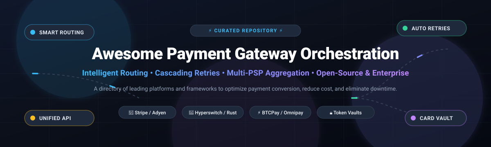

  

# 🌐 Awesome Payment Gateway Orchestration 💳✨

> 🚀 A curated list of top **Payment Gateway Orchestration** platforms, dynamic routing engines, cascading retry systems, and multi-PSP aggregators — featuring enterprise SaaS providers alongside self-hosted, open-source alternatives.
> 
> 🌟 **Star this repository if you find it helpful!** 🌟

---

## 📑 Table of Contents

- [🔍 Sector Overview & Market Dynamics](#-sector-overview--market-dynamics)
- [🏢 SaaS & Hosted Payment Platforms](#-saas--hosted-payment-platforms)
- [💻 Open-Source Orchestrators & Gateways](#-open-source-orchestrators--gateways)
- [📊 Feature Comparison at a Glance](#-feature-comparison-at-a-glance)
- [🎯 Key Selection Criteria & Architectural Patterns](#-key-selection-criteria--architectural-patterns)
- [🤝 Contributing](#-contributing)
- [💖 Support](#-support)
- [📈 Star History](#-star-history)
- [📄 License](#-license)

---

## 🔍 Sector Overview & Market Dynamics

The global **Payment Orchestration Platform (POP)** market is estimated at **$2.85B – $3.33B in 2026** and projected to surge past **$7B – $15B+ by 2030** (growing at an estimated 18–24% CAGR), catalyzed by surging cross-border eCommerce, real-time payment rails (Pix, UPI, FedNow), and complex regional compliance mandates (such as PCI DSS v4.0). 📈

The sector is **moderately to highly fragmented**, rather than a winner-take-all monopoly:
- **No Single PSP Dominance:** Because consumer payment methods remain hyper-fragmented across geographical corridors (e.g., UPI in India, Pix in Brazil, iDEAL/Carte Bancaire in Europe, digital wallets globally), no individual payment gateway can optimize acceptance rates or pricing globally on its own.
- **Provider Coexistence:** Standalone agnostic orchestrators, enterprise cloud gateways (like Stripe, Adyen, and Checkout.com), and acquirer-independent open-source switches (such as Hyperswitch) actively coexist. Merchants systematically adopt multi-provider orchestration layers to safeguard against gateway outages, minimize interchange costs, and prevent vendor lock-in. 🛡️

---

## 🏢 SaaS & Hosted Payment Platforms

Commercial, cloud-hosted Payment Gateways and enterprise platforms featuring intelligent routing, global checkout localization, and orchestration capabilities. Sorted descending by company scale (market capitalization / enterprise valuation / parent company valuation). 💼

| Platform | Valuation / Revenue Scale 📈 | Starting Pricing Tier 💳 | Free Tier / Trial Limit ⏱️ | Orchestration & Core Strengths ⚙️ |
|---|---|---|---|---|
| **[Visa CyberSource](https://www.cybersource.com)** | **~$600B+** (Visa Parent Mkt Cap; CyberSource acquired for $2B) | **$0.10 – $0.20** per transaction gateway fee + custom acquiring markup | **Merchant Test Sandbox only**; No live transaction free tier or free trial days | Enterprise-grade fraud management (*Decision Manager*), token management service, 3-D Secure 2.0 routing, and acquirer-agnostic connections. |
| **[PayPal Braintree](https://www.braintreepayments.com)** | **~$65B – $70B+** (PayPal Parent Mkt Cap; ~$30B+ net rev) | **2.59% + $0.49** per standard US card transaction | **Full API Sandbox only**; No live free transaction volume or free trial days | Universal Drop-in UI for PCI compliance, deep PayPal & Venmo native integration, global multi-currency checkout, and multi-processor vaulting. |
| **[Stripe](https://stripe.com)** | **~$70B** valuation (processed >$1T transaction volume) | **2.9% + $0.30** per successful domestic card charge | **Developer Sandbox with test clock**; No live free transaction quota or production trial | Developer-first API standard; multi-processor routing via *Stripe Connect*, unified billing, global payouts, radar fraud prevention, and network tokens. |
| **[Adyen](https://www.adyen.com)** | **~$40B – $45B** Mkt Cap (€1.9B+ net revenue) | **€0.11 ($0.12)** fixed processing fee + regional Interchange++ | **Test Account Sandbox environment**; Zero live free transaction volume or trial period | Single-platform full-stack gateway, acquirer, and POS processor; automated smart routing, direct card network connections, and unified commerce data. |
| **[Worldpay](https://www.worldpay.com)** | **~$18.5B** valuation (GTCR majority acquisition; $2T+ volume) | **Interchange + 0.15% to 0.60% + $0.10 – $0.20** (or ~1.5% - 2.75% blended) | **Developer Testing Sandbox**; No free live tier or promotional trial days | Heavyweight global acquiring infrastructure, intelligent transaction routing, fallback recovery, and multi-currency settlement across 146+ countries. |
| **[Checkout.com](https://www.checkout.com)** | **~$11B** valuation (peak $40B valuation) | **Interchange++ with ~0.95% + €0.02** starting acquirer/gateway markup | **Free Developer Sandbox**; 100% free live processing exclusively for registered non-profit charities | Enterprise AI-powered *Intelligent Acceptance*, network token optimization, domestic processing in 50+ countries, and granular cost transparency. |
| **[Mollie](https://www.mollie.com)** | **~$6.5B** valuation (€100M+ revenue) | **€0.25 + 1.2% – 1.8%** per EU card transaction (iDEAL at fixed €0.29) | **Free Staging Sandbox**; Pay-as-you-go with 0 live free volume or free trial days | Effortless European localized payments (iDEAL, Bancontact, SEPA, Klarna), plug-and-play e-commerce integrations, and transparent flat fees with no monthly lock-in. |

---

## 💻 Open-Source Orchestrators & Gateways

Community-driven, self-hosted, and transparent payment orchestration platforms, routing libraries, and crypto processors. Sorted descending by GitHub stargazers count. 🌟

| Project | GitHub_Stars ⭐️ | Stack & Architecture 🛠️ | License 📜 | Best Use Case & Capabilities 🚀 |
|---|---|---|---|---|
| **[Juspay Hyperswitch](https://github.com/juspay/hyperswitch)** |  | **Rust** / Composable Microservices | Apache-2.0 | **Production-grade Payment Orchestrator**: Connects 200+ payment methods & 50+ PSPs via a single API; DSL-based dynamic routing, automated smart retries (+2-5% auth uplift), vendor-neutral card vault, and horizontal scaling to 5,000 TPS. |
| **[BTCPay Server](https://github.com/btcpayserver/btcpayserver)** |  | **C# / .NET Core** | MIT | **Non-Custodial Crypto Gateway**: Self-hosted Bitcoin & Lightning Network payment processor with zero processing fees, direct merchant wallet settlements, automated invoicing, and no third-party custodian. |
| **[Omnipay](https://github.com/thephpleague/omnipay)** |  | **PHP** / Modular Architecture | MIT | **Multi-Gateway PHP Abstraction**: Clean, modern, and unit-tested interface for payment processing across dozens of payment gateways (Stripe, PayPal, Authorize.Net, Worldpay) with a consistent, expressive API. |
| **[Kill Bill](https://github.com/killbill/killbill)** |  | **Java** / OSGi Modular Plugins | Apache-2.0 | **Subscription Billing & Multi-PSP Engine**: Enterprise recurring billing, subscription catalog management, and payment routing engine supporting multiple concurrent processor plugins with custom retry schedules. |
| **[ActiveMerchant](https://github.com/activemerchant/active_merchant)** |  | **Ruby** / Rails Monolith Heritage | MIT | **Classic Ruby Gateway Abstraction**: Extracted from Shopify; provides unified API wrappers for over 100+ payment gateways, simplifying card authorizations, captures, and refunds across heterogeneous providers. |
| **[Spree Gateway](https://github.com/spree/spree_gateway)** |  | **Ruby** / Spree Commerce Module | BSD-3-Clause | **E-Commerce Multi-Gateway Plugin**: Official gateway aggregator for the Spree commerce ecosystem, wrapping multiple processors (Stripe, Braintree, Authorize.Net) inside standard e-commerce state machines. |
| **[Paymux](https://github.com/velixio/paymux)** |  | **Go** / Single Binary Deployment | MIT | **Lightweight Self-Hosted Orchestrator**: Single Go binary routing regional & global gateways (Stripe, Razorpay, Cashfree, PayU, Whop) behind a unified API, double-entry ledger, and unified webhook multiplexer. |
| **[python-getpaid-core](https://github.com/django-getpaid/python-getpaid-core)** |  | **Python** / Framework-Agnostic Core | MIT | **Semantic Python Payment Engine**: Abstract base interfaces and state-machine transitions (NEW → PREPARED → PAID) with adapters for Django, FastAPI, and Litestar, plus processor plugins for PayU, Przelewy24, and BitPay. |

---

## 📊 Feature Comparison at a Glance

| Software / Solution | Deployment Model | Open Source? | Multi-PSP Orchestration | Dynamic Smart Routing | Zero Vendor Lock-in Vault | Ideal Target Organization |
|---|---|:---:|:---:|:---:|:---:|---|
| **Visa CyberSource** | Cloud Hosted | ❌ | ✅ (Via Decision Mgr) | Acquirer-Dependent | Custom Vault | Large Global Enterprises, High-Risk Merchants |
| **PayPal Braintree** | Cloud Hosted | ❌ | ⚠️ (PayPal Ecosystem) | ❌ | Limited | SMBs to Mid-Market, Web3 & PayPal heavy buyers |
| **Stripe** | Cloud Hosted | ❌ | ⚠️ (Via Stripe Connect) | Internal Only | Proprietary Vault | Startups, SaaS, Global Marketplaces |
| **Adyen** | Full-Stack Cloud | ❌ | ⚠️ (Inside Adyen Rail) | ✅ Native Engine | Unified Token | Omnichannel Retail, Enterprise Direct Acquirers |
| **Worldpay** | Cloud Hosted | ❌ | ✅ Global Acquiring | ✅ Dynamic Rules | Acquirer Vault | High-Volume Retailers, Global POS/Online |
| **Checkout.com** | Cloud Hosted | ❌ | ⚠️ (Inside Checkout) | ✅ AI Acceptance | Network Tokens | Scaling Tech, Cross-Border E-Commerce |
| **Mollie** | Cloud Hosted | ❌ | ❌ (Single Gateway) | ❌ | Standard | European Startups, SMB E-commerce Stores |
| **Juspay Hyperswitch** | Self-Hosted / BYOC | ✅ | ✅ 50+ Processors | ✅ Rule & Cost DSL | ✅ Open Vault | FinTechs, Enterprise Scale, Cost-Conscious Teams |
| **BTCPay Server** | Self-Hosted | ✅ | ⚠️ (Crypto Rails) | ❌ | Non-Custodial | Privacy Advocates, Crypto-Native Retailers |
| **Omnipay** | Self-Hosted Library | ✅ | ✅ Via Drivers | ❌ Code-level | ❌ | PHP & Laravel Application Engineers |
| **Kill Bill** | Self-Hosted Server | ✅ | ✅ Plugin Driven | ⚠️ Rule Config | Plugin Dependent | Subscription Businesses, Custom SaaS Invoicing |
| **ActiveMerchant** | Ruby Gem Library | ✅ | ✅ Via Drivers | ❌ Code-level | ❌ | Ruby on Rails Monoliths, Custom Storefronts |
| **Paymux** | Self-Hosted Binary | ✅ | ✅ Unified API | ⚠️ Webhook Ledger | Internal Ledger | Developers needing minimal-footprint Go routing |

---

## 🎯 Key Selection Criteria & Architectural Patterns

When architecting a fault-tolerant payment stack, engineering and finance teams evaluate solutions along four structural pillars:

1. **Routing Intelligence & Cascading Retries (Auth Rate Optimization):**
   * *Soft Decline Recovery:* Automatically retrying a card declined due to temporary issuer downtime or network glitches against a secondary acquirer can recover **2% to 5% of top-line revenue**.
   * *Cost & Currency Routing:* Routing domestic transactions through local acquirers (e.g., Cartes Bancaires in France or Girocard in Germany) drastically slashes cross-border interchange markups.
2. **Payment Card & Credential Vaulting (Portability):**
   * Storing credit card tokens within a single proprietary gateway creates severe vendor lock-in. Independent token vaults (like Hyperswitch Vault or third-party tokenizers) decouple tokens from processors, allowing seamless switching without merchant card re-entry.
3. **Reconciliation & Ledgering:**
   * Multi-processor setups multiply settlement complexity. Platforms providing unified fee observability, dispute aggregation, and double-entry accounting reconciliation eliminate manual financial operations.
4. **Compliance & Maintenance Overhead:**
   * While open-source platforms like Hyperswitch give complete control and zero volume-based software markups, self-hosting requires maintaining high availability (99.999%), PCI DSS Level 1 audits, HSM key management, and continuous API connector updates.

---

## 🤝 Contributing

Contributions, feedback, and additions are welcome! 💡

If you know of a production-tested open-source Payment Orchestration tool, unified driver library, or platform that should be included:
1. Fork this repository 🍴
2. Create your feature branch (`git checkout -b feature/new-payment-tool`)
3. Ensure the project is active (commits/releases within the past 12 months) and open-source
4. Commit your changes (`git commit -m "Add New Payment Orchestrator"`)
5. Push to the branch and open a Pull Request! 🎉

---

## 💖 Support

Thank you for exploring and utilizing this curated directory! If you find this project valuable for your work, research, or product architecture, please consider supporting the project:

- 🌟 **Star** this repository to help boost visibility for the community!
- 🍴 **Fork** the project to contribute additions and improvements.
- 📢 **Share** it with your engineering and fintech networks.
- ☕ **Buy a Coffee / Sponsor**: Support ongoing maintenance and curation on the [GitHub Sponsors Dashboard](https://github.com/sponsors/ishandutta2007).

Your support is deeply appreciated! ❤️

---

##  Star History

---

## 📄 License

This repository and curated compilation are released under the [Creative Commons Zero v1.0 Universal](LICENSE) (CC0 1.0 - Public Domain). Individual projects mentioned retain their respective licenses and trademarks.

---

  Built with ❤️ for payment engineers, fintech architects, and commerce builders worldwide. ⭐ Star us on GitHub!

